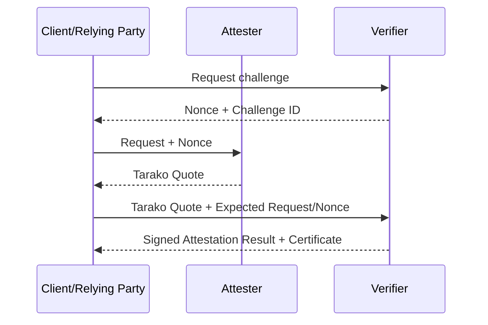

# TARAKO — An application attestation mechanism for confidential VMs

Trusted Application Remote Attestation Kernel Object (TARAKO) is a Linux kernel module for measuring running applications, intended for use in confidential VMs such as those based on [Intel TDX].
This module exposes a virtual device at `/dev/tarako` that returns a signed measurement of the caller's binary when invoked.
This can be used for remote attestation.

[Intel TDX]: https://www.intel.com/content/www/us/en/developer/tools/trust-domain-extensions/overview.html

## What this solves

Confidential VMs lack an easy way to prove which application is running in userspace.
Confidential VMs are mostly used for security-sensitive applications in the cloud, where the goal is to protect the VM from attacks by the host and other VMs.
However, a critical issue is that this protection does not extend to threats originating within the VM.
Malware running inside the VM may compromise userspace.

TARAKO allows an external client to verify the integrity of a userspace application's binary through remote attestation.

It is intended to be used in combination with remote attestation of the confidential VM itself.

The separate [early TLS attestation PoC](tools/tls-attester/README.md) binds a TARAKO quote and mock platform evidence to a TLS 1.3 handshake.

## Required facilities

This module requires a kernel with the following features enabled:

- [Linux IMA]
- [fs-verity]

It also requires the following module:

- `ecc`

[Linux IMA]: https://ima-doc.readthedocs.io/en/latest/ima-concepts.html
[fs-verity]: https://www.kernel.org/doc/html/latest/filesystems/fsverity.html

## How it works

When the module is loaded, it generates a fresh ECDSA key pair and exposes a virtual device at `/dev/tarako`.
The public key is recorded in the IMA log.
When an application invokes the device using the signing ioctl, the device returns the application's fs-verity digest and a signature.

The digest and signature can be passed to the client, which can independently check the digest and verify the signature.

## Architecture

This documentation follows the Background-Check Model in [RATS].

[RATS]: https://www.rfc-editor.org/rfc/rfc9334.html

The client requests evidence from the attester.

We assume that the client has already remotely attested the confidential VM and checked the IMA log, which includes TARAKO's public key.



**Attester** (runs the kernel module):
1. Loads the `tarako` module — an ECDSA P-256 key pair is generated in kernel space.
2. The private key never leaves the kernel and is zeroized on module unload.
3. The fs-verity-protected C simple attester accepts a request from the Client and a nonce from the Verifier, calls `TARAKO_SIGN_DATA` directly, and returns Tarako Quote Evidence to the Client.

## Build & Test

The flake supports `x86_64-linux` only.

```sh
# Kernel module
nix build .#default

# C attester (HTTP server and command-line quote generation)
nix build .#simple-attester

# TLS server, TLS client, and shared evidence code
nix build .#tls-attester .#tls-client .#libtarako

# NixOS VM attestation test
nix flake check
```

The [simple attester](tools/simple-attester/) serves `POST /quote` by default. Its `tarako-simple-attester quote [hex-user-data]` command generates a quote directly; without user data, it generates a fresh random 32-byte nonce. Signing requires running an fs-verity-protected copy of the binary.

The demo tools share [`tools/libtarako`](tools/libtarako/).
The attesters are statically linked so their fs-verity digests cover the library
code and dependencies. The TLS client links its system libraries dynamically.
To use the TARAKO packages in another flake, add `tarako.overlays.default`
to that flake’s nixpkgs overlays.

### Running the test on TDX

See the [live TDX runbook](live-tdx/README.md) for running the HTTP/2 attestation test on an Intel TDX host.

## How the signing works

1. On load, the module generates an ECDSA P-256 key pair. The curve order `n` is cached.
2. When `TARAKO_SIGN_DATA` is called, the kernel:
   - Reads the calling process's fs-verity digest (SHA-256 of the file's Merkle tree root) using `get_task_exe_file`.
   - Concatenates it with 128 bytes of opaque user data from userspace.
   - Computes `SHA256(digest || user_data)` and reduces it modulo `n`.
   - Signs the result with ECDSA P-256 using kernel `ecc_*` helpers.
   - Returns the signature in big-endian wire format and the compressed SEC1 public key.
